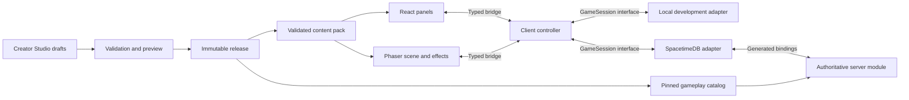

# Aether — Client-First Architecture and Development Roadmap

This is an architecture and development plan, not an implementation. The current repository contains the game specification; the applications, packages, editors, and server described below are proposed work.

[Dawnwell Glade — First Multiplayer Slice](game-design.md) remains the source of truth for gameplay, stable content IDs, numeric values, persistence, and final acceptance scenarios. This roadmap adds architectural recommendations and identifies decisions that still need resolution. It does not replace or change those gameplay rules.

## 1. Architecture recommendation

Use one monorepo with **two Next.js applications, two initial shared packages, and one TypeScript SpacetimeDB module**:

- **Game Client:** Build first. React provides the shell and panels; Phaser renders reusable content and presents observed game state.
- **Creator Studio:** Add after the local client works. Keep sprite preparation, content forms, draft management, and previews inside one application. Start as a trusted local developer tool.
- **Content package:** Own definition contracts, runtime schema validation, asset conventions, reference checks, and release manifests.
- **Game Core package:** Own application-level commands, snapshots, events, supported behavior vocabulary, and reusable pure calculations. Keep it independent of React, Phaser, browser storage, and SpacetimeDB SDK types.
- **SpacetimeDB module:** Own production identity, membership, simulation, rewards, privacy, persistence, and recovery. Consume the same validated gameplay catalog that produces the client's content pack.

Start with manually authored sample content and a development-only local adapter. Complete the Dawnwell client experience before building the broader editor suite. Immediately afterward, run a bounded real multiplayer spike to prove the adapter, identity, room, privacy, and clock boundaries. Full authoritative integration remains a later milestone.

The eleven requested modules are logical responsibilities, not eleven applications or services. Extract a shared renderer package only when Studio previews actually need it. Begin with workspace packages and ordinary build scripts; a custom plugin framework or distributed service architecture would add unnecessary initial work.



The local and SpacetimeDB adapters are alternative session implementations. Production outcomes come exclusively from the server. Studio previews run in an isolated local session and cannot write production character progress.

### React, Phaser, and networking boundaries

Use one client controller to connect the session adapter, observed-state store, React panels, and Phaser scene. Neither UI layer directly mutates a simulated or server-owned character.

| Contract | Responsibilities |
| --- | --- |
| `GameSession` | Connect/disconnect, readiness and connection status, submit typed intentions, subscribe/unsubscribe to room and personal snapshots, receive command feedback and presentation events, and expose an estimated authority clock |
| Client intentions | Destination request, target selection, one action request, quest acceptance/turn-in, equipment change, chat submission, and character creation/customization when supported |
| Observed snapshots | Current content release, room entities, owner-authorized progression/inventory/recovery, and connection readiness; no mutable Phaser objects or SDK table handles |
| Presentation events | Accepted hits, healing, death, respawn, rewards, dialogue feedback, and command rejection; use event/encounter identities to avoid replaying effects |
| React-to-controller bridge | Gameplay requests from panels, panel visibility, and text-input focus |
| Phaser-to-controller bridge | Ground-click intentions, target selection, and NPC interaction intentions |
| Controller-to-Phaser bridge | Read-only render snapshots, input-enabled state, selection feedback, and accepted presentation events |

Keep content IDs separate from character IDs, enemy instance IDs, encounter IDs, and inventory ownership IDs. At the adapter boundary, normalize runtime IDs to opaque strings and timestamps to milliseconds. Translate generated SDK identities, integer types, and timestamps inside the network adapter.

React receives subscribed state updates; Phaser interpolates scene positions on its own loop. Do not push every rendered animation frame through React. Animation frames do not decide damage, mana spending, cooldowns, or rewards.

Mount and destroy the Phaser game through a browser-only host lifecycle. Declare the dynamic import with server rendering disabled inside a Client Component; a client directive alone does not disable prerendering. [Next.js lazy-loading guidance](https://nextjs.org/docs/app/guides/lazy-loading).

The local adapter owns a deterministic development simulation with a controllable clock and seeded fixtures. Its browser-storage progress and simulated connection failures are disposable development data, kept separate from real guest tokens. The production entrypoint selects the SpacetimeDB adapter explicitly and excludes the local simulator. Do not recreate the generated `DbConnection` API in the local adapter; wrap it behind `GameSession`. [SpacetimeDB TypeScript SDK](https://spacetimedb.com/docs/clients/typescript/).

## 2. Module responsibilities and dependencies

| Module | Owner | Inputs | Outputs | Dependencies | Boundary |
| --- | --- | --- | --- | --- | --- |
| Game Client | Game Client app | Validated definitions/assets, observed session state, player input | Scene, panels, effects, and typed intentions | Content, Game Core, selected adapter | Presentation and input; production results come from server state |
| Sprite and Animation Builder | Studio sprite tool | Existing original images/sheets, frame metadata | Sprite definitions, clips, anchors, layer compatibility, attachments, prepared assets | Asset browser, content validation, client preview | Prepares artwork; generation or drawing is a separate activity |
| Character Creator | Game Client picker; Studio appearance catalog | Compatible bodies, hair, faces, palettes, cosmetics, defaults | Cosmetic appearance selection and validated appearance definitions | Sprite tooling and appearance contracts | Players select prepared assets; creators prepare them; cosmetics do not change stats |
| Map Builder | Studio map tool | Backgrounds, rectangle regions, spawn coordinates, enemy/NPC references | Map definitions and placement preview | Assets, enemy catalog, NPC stubs, client scene | V1 uses Dawnwell geometry; portals and new movement models require later runtime support |
| Class and Skill Builder | Studio class/skill tools | Supported effect presets, stats, progression, targeting, costs, ranges, timings | Class and skill definitions | Content contracts, Game Core behavior vocabulary, icons/effects | Configure supported mechanics; do not execute author-supplied formulas or scripts |
| Item Builder | Studio item tool | Item kinds, weapon bonuses, stacking, icons, visual references | Item definitions | Asset browser and supported inventory/equipment rules | V1 weapon slot and quest materials; no commerce or crafting |
| Enemy Builder | Studio enemy tool | Stats, supported attack/AI preset, leash, respawn, rewards | Enemy definitions and preview | Supported effects, items, sprites, runtime presets | Configures first-attacker pursuit and personal rewards; new AI needs code |
| Quest Builder | Studio quest tool | Prerequisites, supported objectives, item/NPC references, consumption, rewards | Quest definitions and progress preview | Items, NPC catalog, supported objective/reward logic | Server validates progress and atomic completion |
| Story and Dialogue Builder | Studio dialogue tool | NPCs, text nodes, choices, conditions, quest references | Dialogue graphs, NPC conversation definitions | NPC stubs, quest catalog, client dialogue renderer | Narrative nodes request actions; they cannot directly grant items/XP or complete quests |
| Game Server and Multiplayer | SpacetimeDB module; client adapter | Authenticated intentions, pinned catalog, server-owned state/time | Authorized snapshots/events, saved progress, runtime/recovery state | Content, Game Core, generated bindings | Authority, ownership, privacy, concurrency, scheduling, and cleanup |
| Content Management and Publishing | Studio workspace plus release scripts | Assets, definitions, drafts, runtime compatibility | Validated drafts, immutable packs, publication/activation records | All authored definitions, validators, isolated preview | Draft saving and publication are separate; no direct editing of active room content |

An NPC can initially be a small hand-authored definition linking a prepared appearance to a dialogue entry. This breaks the authoring dependency cycle: Map Builder can place Mira before the Quest and Dialogue Builders exist. Those later builders complete her references and behavior.

## 3. Proposed monorepo structure

```text
aether/
  apps/
    game-client/
      src/
        app/                    # Next.js routes and browser-only game host
        game/                   # Phaser scenes, actors, assets, client controller
        bridge/                 # Typed React/Phaser integration
        adapters/
          local/                # Development-only simulator and fixtures
          spacetimedb/          # Generated bindings wrapper and mapping
        ui/                     # HUD, inventory, dialogue, quests, chat
    creator-studio/             # Create when sprite tooling begins
      src/
        app/
        modules/                # Assets, sprites, appearances, maps, classes,
                                # skills, items, enemies, quests, dialogue
        workspace/              # Draft storage, validation, preview, export
  packages/
    content/                    # Definition schemas/types, manifest, validation
    game-core/                  # Session contracts, behavior vocabulary, pure math
  server/
    spacetimedb/                # Tables, views, reducers, scheduled simulation
  content/
    dawnwell-glade/
      definitions/              # Hand-authored first, then Studio-produced
      assets/                   # Prepared original runtime images/audio
      manifest/                 # Logical asset references and pack metadata
  assets/
    source/                     # Original editable art/audio and provenance
  tools/
    content/                    # Validation, pack export, staging/activation scripts
  docs/
    game-design.md
    development-roadmap.md
```

Use pnpm workspaces as the proposed package-management default. Pin runtime/tool versions when implementation starts. Generated bindings remain adapter-local and are regenerated from the server module; they do not become an independent source of gameplay contracts. Build outputs and immutable release archives are generated artifacts, separate from editable source.

Initially keep Phaser code in the Game Client. When Studio needs the same renderer for previews, extract its browser-only scene/asset/controller components into `packages/game-runtime`. Keep app routes, production networking, and player panels in the Game Client unless they truly have a second consumer.

## 4. Milestone roadmap

Milestones are completion gates, not date estimates. Each builder stage delivers a small usable tool against content the client already understands.

### M1 — Minimum shared contracts and asset conventions

- **Goal/scope:** Define the smallest reusable vocabulary that represents Dawnwell faithfully, before client development. Author the first pack by hand.
- **Modules:** Content Management; Game Client contracts; definition interfaces for each future builder.
- **Dependencies:** The unchanged game specification.
- **Deliverables:** Definition/manifest schemas, reference validator, supported behavior vocabulary, asset conventions, sample pack, `GameSession`/snapshot/event contracts, and fixtures for the source values.
- **Acceptance:** All source IDs, positions, values, state rules, and references validate. Invalid or unsupported definitions fail clearly. The client will obtain gameplay data from definitions rather than Dawnwell-specific scene/UI branches.
- **Deferred:** Editor UIs, arbitrary scripting, advanced map geometry, database schemas, and remote creator access.

### M2 — Local Game Client foundation

- **Goal/scope:** Boot the Next.js shell and client-only Phaser scene using reusable sample content.
- **Modules:** Game Client, content loader, local adapter.
- **Dependencies:** M1 contracts and assets sufficient for an initial scene.
- **Deliverables:** Safe scene lifecycle, asset loading, fixed-world display scaling, typed bridge, observed-state store, local adapter, scene actors, basic HUD, and loading/error/connection feedback.
- **Acceptance:** Phaser does not execute during server rendering. Resize preserves world coordinates. Remount/reload does not duplicate games, listeners, or inputs. Map/actor assets and positions load from the pack. A test fixture with different supported placements loads without editing scene logic.
- **Deferred:** Complete combat/progression flow, real multiplayer, and Creator Studio.

### M3 — Dawnwell client experience with sample content

- **Goal/scope:** Complete the local presentation and interaction loop using one default Guardian appearance and deterministic simulation.
- **Modules:** Game Client consuming map, sprite, class, skill, enemy, item, quest, NPC, and dialogue definitions.
- **Dependencies:** M2.
- **Deliverables:** Click movement, targeting, manual attack/approach/cancellation, combat animations/effects, HUD, inventory/equipment, Mira dialogue, shard tracking and turn-in, local progress, chat presentation, and simulated connection feedback.
- **Acceptance:** Local checks reproduce damage 10/22/8, Mend 36, exact range/timing feedback, safe boundary, and one-input/one-strike semantics. Five quest kills plus turn-in yield 175 XP and 50 gold; the level-2 reward weapon yields 17 attack. Level 3 caps XP at 300. Panels and typing do not trigger game actions.
- **Deferred:** Verified concurrent rewards, secure persistence, real chat delivery, authorization, and actual reconnect guarantees.

Local additional-player fixtures and simulated disconnects are presentation demonstrations. They do not satisfy the multiplayer acceptance scenarios.

### M3a — Early real multiplayer integration gate

- **Goal/scope:** Reduce networking and authority risk before investing in editors. Keep this bounded to identity, movement, subscriptions/privacy, and one server deadline round trip.
- **Modules:** Game Server and Multiplayer, Game Client.
- **Dependencies:** M3's working client and application-owned session contracts.
- **Deliverables:** TypeScript module setup, generated bindings, `SpacetimeDbAdapter`, guest-token reuse, server membership/position, indexed authorized views, a published test catalog revision, and real connection feedback.
- **Acceptance:** Two separate browser identities actually see each other move at speed 180. Forged positions do not control server position. Another identity cannot read an owner-private test record. Room views derive membership server-side. Commands wait for subscription readiness and stale commands are not replayed. A deadline is based on server time and survives connection recreation.
- **Deferred:** Full combat/reward/progression reducers, comprehensive reconnect/grace testing, and production publishing.

This gate proves the interface and selected server capabilities. It does not certify the completed multiplayer slice. Its timing is the recommended addition to the requested client-first sequence.

### M4 — Sprite preparation and character customization

- **Goal/scope:** Prepare original artwork for the existing renderer, then let players select a small compatible appearance set.
- **Modules:** Sprite and Animation Builder, Character Creator, shared asset browser.
- **Dependencies:** A client that consumes sprite/appearance contracts; M3a confirms the session boundary before deeper tool investment.
- **Deliverables:** Studio import, sheet/frame setup, clip preview, ground anchors, facing, layer compatibility, weapon overlays, attachment markers, and validated export. Add player-facing choices for prepared body/hair/face/palette/cosmetics and an appearance catalog.
- **Acceptance:** Exported assets load into the existing client without special-case code. Required clips keep their ground anchor, both facings work, and the two weapons preview correctly. Incompatible components fail validation. Appearance choices are cosmetic. Local selection persistence is demonstrated; production persistence is completed at M6.
- **Deferred:** Artwork generation, skeletal authoring, arbitrary rigs/animation graphs, large cosmetic catalogs, and cosmetic commerce.

### M5 — Incremental builders in dependency order

Shared prerequisites are M1 contracts, M3 runtime behavior, and M4 asset preparation. Every stage must save/reopen a draft, validate it, and preview its export through the client's existing loader. Add authoring fields only when runtime support exists.

| Stage | Goal and modules | Additional dependencies | Concrete deliverables | Acceptance gate | Deferred |
| --- | --- | --- | --- | --- | --- |
| M5a | Asset browser/drafts, Class and Skill Builder, Item Builder | Prepared assets and supported action/equipment vocabulary | Small forms for Guardian, its three actions, and the three item definitions; reusable draft/reference validation | Existing definitions round-trip without value changes; invalid costs, effects, item kinds, and asset references fail | New resource systems, arbitrary formulas, more equipment slots |
| M5b | Enemy Builder | M5a effects and item catalog | Thornling stats, melee-pursuit preset, aggro/retarget, leash, respawn, personal rewards, behavior preview | Export reproduces specified Thornling behavior and reward parameters | Custom AI scripts, bosses, population scaling |
| M5c | Map Builder | Enemy catalog, backgrounds, and hand-authored NPC stub | Rectangle/safe-boundary editing, spawns, four enemy placements, Mira placement, coordinate preview | Recreate Dawnwell's exact geometry and placements; invalid bounds and references fail | Obstacles/pathfinding, portals, multiple playable maps |
| M5d | Quest Builder, Story and Dialogue Builder | Items, NPC stub, map catalog, supported quest/condition vocabulary | Steady the Dawnwell objectives/turn-in/rewards, Mira conversation nodes/choices, reference and reachability checks | Five-shard consume/reward flow previews correctly; dialogue requests actions while quest logic determines eligibility | Quest chains, arbitrary narrative scripting, shared quest completion, general story-flag workflows |

Publication remains a separate operation. A draft preview can change local test values without changing the baseline Dawnwell pack or active server content.

### M6 — Complete authoritative Dawnwell multiplayer slice

- **Goal/scope:** Replace simulated outcomes with server-owned movement, combat, enemy behavior, personal rewards, saved progress, room chat, and recovery.
- **Modules:** Game Server and Multiplayer, Game Client, Content Management; builders supply definitions.
- **Dependencies:** M3a, the completed local loop, and stable validated contracts. M5 exports exercise the pipeline, but editor polish is not a blocker for authority work against the valid hand-authored pack.
- **Deliverables:** Saved progression and recovery records, explicit room/encounter cleanup, scheduled server simulation, atomic combat/defeat/quest/equipment operations, authorized views, production adapter, guest identity, chat, and reconnect UI.
- **Acceptance:** Run every scenario in [the source specification](game-design.md#acceptance-scenarios) using real clients. Include hostile requests, simultaneous lethal hits, dead/respawned/disconnected contributors, safe-boundary enforcement, subscription privacy, short/late reconnect, retained presence counting toward eight, ninth-entry rejection, saved progress, and repeat-safe quest completion.
- **Deferred:** Advanced world expansion and the originally excluded economic/social systems.

The final slice gate requires two fresh browser identities to complete five shared kills, independently turn in the quest, equip their own reward, and reconnect with progress intact. A local simulation result cannot substitute for this evidence.

### M7 — Integrated publishing and closed-alpha readiness

- **Goal/scope:** Make validated Studio content safely playable and establish operations for invited players.
- **Modules:** Content Management and Publishing, all builders, Game Client, Game Server and Multiplayer.
- **Dependencies:** M6's authoritative slice and builder exports that pass the shared validator.
- **Deliverables:** Immutable release packs, isolated previews, compatibility checks, staged activation, private creator/publish access, logs, backup/restore procedure, basic administration, defined chat/abuse controls, and browser/performance checks.
- **Acceptance:** Drafts never change active gameplay. Missing references/assets and unsupported mechanics block publication. Client/server release mismatch blocks entry clearly. A staged release passes the full source acceptance suite, activation/recovery is rehearsed, and rollback preserves owned content. Invited playtests measure the two-minute control understanding, roughly 5–10 minute introduction, and cooperative value.
- **Deferred:** Seamless hot content migration, multi-version live worlds, advanced moderation dashboards, and advanced world expansion.

## 5. Shared content and publishing strategy

### Minimum content contracts

Use data definitions validated at load/export time, with TypeScript types derived from the same schema source. Definitions have stable IDs; cross-references use IDs rather than file paths or display names. Keep executable behavior in tested runtime/server code.

| Definition | Minimum v1 contract |
| --- | --- |
| Pack manifest | Schema version, immutable release ID/hash, required runtime/protocol compatibility, definition index, asset index, and provenance |
| Map | World dimensions and coordinate convention, walk rectangle, safe boundary, player spawn, named enemy placements, NPC placements, background references |
| Character template | Default class, initial inventory/equipment, default appearance, and visual archetype; actual owner/progression lives in saved state |
| Appearance | Rig family, body/hair/face/cosmetic component references, supported palette selections, layer order, and compatible sprite set |
| Sprite/animation | Asset/frame references, dimensions/regions, ground anchor, world scale, facing, clips/frame timing/looping, layer compatibility, named attachment points |
| Class | Base stats, level increments, cumulative XP thresholds/cap, movement/range parameters, and available skill IDs |
| Skill | Supported effect kind, targeting, attack multiplier or fixed heal, mana cost, range, cooldown, recovery, and presentation references |
| Item | Kind, stack behavior, icon, weapon slot/bonus where applicable, and optional equipment visual reference |
| Enemy | Stats, attack parameters, supported behavior preset, speed/range, aggro/retarget policy, leash, respawn, and personal reward references |
| Quest | Supported prerequisites/objective, available/active/completed states, collection conditions, turn-in NPC/range, item consumption, and completion rewards |
| NPC | Appearance, dialogue entry, interaction range, and quest references |
| Dialogue | Entry node, text/choices, node links, presentation conditions, and supported quest-request intentions |
| Room/recovery rules | Eight-character cap, 30-second grace, five-second death respawn, out-of-combat delay/regeneration, and equipment combat restriction |

Map portals and general story flags are explicit future extensions. V1 dialogue conditions can read existing quest state; it need not introduce a general story-flag database. V1 walk regions are rectangles, matching Dawnwell; authoring polygons does not imply pathfinding support.

Preserve the existing IDs: `dawnwell_glade`, `guardian`, `basic_attack`, `heavy_strike`, `mend`, `thornling`, `keeper_mira`, `steady_the_dawnwell`, `training_blade`, `dawnwell_blade`, and `aether_shard`. New sprite, dialogue, and appearance IDs must be registered; do not rename these gameplay IDs to match filenames or editor labels.

### Behavior presets and changes that require code

The initial behavior vocabulary covers a manual melee hit with an attack multiplier, fixed self-heal, first-damaging-attacker pursuit with contributor retarget/leash reset, personal contributor rewards, inventory collection, and atomic item-consume/quest-reward completion.

Builders configure values and references within that vocabulary. A new mechanic such as a projectile, damage-over-time effect, buff, new AI strategy, new quest condition, or portal transition requires a contract extension, runtime presentation, local adapter support, authoritative server implementation, and relevant tests before a builder may publish it. Do not accept user-entered JavaScript or arbitrary formula strings.

Narrative text and choices remain separate from reward logic. A dialogue choice may request quest acceptance or turn-in; the server checks eligibility, consumes shards, awards rewards, and changes quest state transactionally.

### Asset conventions

- Assign stable logical asset IDs. Authoring paths are workspace-relative; published asset URLs are immutable and include a hash/release reference.
- Preserve original source art/audio and record creator, source, and attribution/license metadata. Artwork generation or drawing is a separate production activity; the Sprite Builder imports and prepares existing original artwork.
- Import PNG sheets/transparent overlays and explicit atlas frame rectangles. Export one normalized frame/clip manifest. Images use declared dimensions and pixel-to-world scale; runtime logic does not infer gameplay bounds from visible pixels.
- Use one Guardian rig family initially: consistent canvas/ground anchor, right-facing source frames, mirrored left-facing rendering, and synchronized frame timing across compatible layers.
- Use frame-aligned overlays for the first body/hair/face/cosmetic/weapon layers. Named per-frame attachment points support hand/effect placement; a later skeletal pipeline is a separate feature.
- Render each assembled character as one ground-position container with ordered visual children; sort the root by ground Y. Phaser container children use list order for rendering. [Phaser container documentation](https://docs.phaser.io/phaser/concepts/gameobjects/container).
- Preserve the source-required Guardian and Thornling clips. Missing clips, incompatible rig families, and misaligned overlays fail validation. Mira can begin with an idle sprite and portrait.
- Palettes and cosmetics affect presentation only. Ground position, collision rules, speed, range, and stats remain independent of visual size.

Exact art dimensions, palettes, frame counts, and clip timing remain art-production decisions recorded in asset metadata. A single prepared default appearance is sufficient for M2/M3.

### Four separate state categories

| Category | Examples and ownership |
| --- | --- |
| Content definitions | Immutable maps, stats, skills, items, quests, NPCs, dialogue, appearances, and asset references; pin to a release |
| Saved character progression | Server-owned identity/name/class, XP, gold, inventory/equipment, quest state; cosmetic appearance selection is the requested new saved-state addition |
| Room/encounter runtime | Presence, positions, destinations, target/pending action, enemy health/aggro, encounter IDs/contributions, and room chat; explicitly cleaned up |
| Recovery runtime | Health/mana, last-damage time, cooldown/shared-recovery deadlines, death/respawn deadline, and disconnect/removal deadlines; retained enough to prevent reconnect resets |

Death does not clear contribution credit or ability cooldowns. Retained disconnected characters remain vulnerable, reward-eligible, and count toward the room cap. Actual removal clears membership/contributions while enough recovery state remains to prevent resource/cooldown resets. Shards stack, surplus persists, and owned equipped weapons remain inventory items. These are source rules, not optional adapter behaviors.

SpacetimeDB tables do not expire merely because the game calls them runtime state. Implement explicit lifecycle cleanup. Private progress/recovery tables are exposed through caller-aware views that derive identity and current-room membership from server records, using indexed lookups. Views take context rather than a client-supplied room argument. [SpacetimeDB views](https://spacetimedb.com/docs/functions/views/).

Use server timestamps and deadline-based calculations. Scheduled execution may skip missed ticks; validate system-only scheduled operations and avoid trusting client time. Simulation cadence is a technical tuning decision for the early integration gate. [SpacetimeDB schedule tables](https://spacetimedb.com/docs/tables/schedule-tables/).

### Drafts, immutable releases, and activation

The recommended first publishing workflow is **draft → validate → isolated preview → immutable package → staged multiplayer verification → maintenance activation**.

1. Store editable drafts/assets in the Studio's trusted local workspace. Preview snapshots are isolated from the baseline pack and production saves.
2. Validate schema, supported mechanics, duplicate IDs, all references, asset existence/checksums, clip/rig compatibility, map placement, dialogue reachability, and reward/quest constraints. Keep a fixture that verifies the baseline Dawnwell values against the source document.
3. Export client presentation content/assets and the server gameplay catalog from the same validated pack. Compile the pinned gameplay catalog into the server module initially; the server does not trust a catalog submitted by a player's browser.
4. Record three different versions: definition **schema version**, exact immutable **content release**, and supported **runtime/protocol compatibility**. Keep the runtime/SDK/bindings artifacts associated with that release.
5. Upload immutable assets, build the matching client and server module, and verify them in staging. The server exposes its active release; the client loads that exact pack before admission. A mismatch disables entry/commands and shows reload/update feedback.
6. For the single-room alpha, use deliberate maintenance activation. Disable entry and gameplay, stop room simulations while preserving progress/recovery records, deploy the staged compatible server/catalog and matching client, switch the active manifest, then reopen admission after checks. Force clients to reload. This maintenance process is separate from ordinary reconnect handling.
7. Retain prior artifacts and take a backup before migration. Rehearse failure recovery. Existing saved item/class/quest IDs must remain valid; rollback to a release lacking newly owned content needs an explicit compatible migration or forward fix.

Saving a draft never changes the active catalog. Avoid live stat/quest edits mid-encounter. Later world expansion can pin distinct releases per room if required.

Publishing the module, web client, and assets is a coordinated release process, not a cross-system transaction. Database compatibility and reducer changes require checks; a destructive database reset is not a progression-preserving rollback. [SpacetimeDB automatic migrations](https://spacetimedb.com/docs/databases/automatic-migrations/).

### Local checks versus real multiplayer evidence

| Local development can establish | Real SpacetimeDB testing must establish |
| --- | --- |
| Definition validation, asset loading, scaling, anchors, compatible appearance layers | Actual identity isolation, owner authorization, and membership-based subscriptions |
| Manual input semantics, pending cancellation, deterministic arithmetic, UI feedback | Server enforcement of speed, range, mana, cooldowns, and authentic timestamps |
| Inventory/quest presentation and simulated progression | Atomic saved rewards, repeat-safe turn-in/equipment, and reload persistence |
| Chat layout and simulated connection states | Room-scoped delivery, disconnect lifecycle, token reuse, and grace-period rules |
| Simulated contributors and effect deduplication | Concurrent lethal actions, contribution eligibility through death/disconnect, room-cap enforcement, and multi-client ordering |

Use all acceptance scenarios from the source document at M6/M7. Record results as local demonstrations, real multiplayer checks, or player playtests, with the tested release identified.

## 6. Key risks and unresolved decisions

These decisions are absent from the source or introduced by the new tooling/customization request. Resolve them before their stated gate; do not silently fill them with gameplay changes.

| Risk or decision | Recommended direction or question | Resolve by |
| --- | --- | --- |
| Local simulator drifting from server semantics | Share pure math and fixtures; keep production authority server-owned; use the early real integration gate | M3a, then M6 |
| Same-identity multiple tabs/connections | Choose one active controlling connection or explicitly track connections. An old tab disconnect must not start grace for an active character | M3a |
| Character naming and appearance | Define naming constraints, permitted components/palettes, and whether existing characters may rename/change appearance. Appearance persistence is new scope and cosmetic | Naming by M3a; appearance by M4 |
| Layered art compatibility and workload | Use one rig family and frame-aligned overlays first. Agree dimensions/clip timings with original asset production before expanding the catalog | M4 |
| General-purpose builders outpacing runtime | Expose only supported effects/objectives/AI; unsupported mechanics require runtime/server work first | Each M5 stage |
| Richer maps and story flags | Rectangles and quest-state dialogue suffice for Dawnwell. Decide transitions, geometry/pathfinding, and general flags when implementing their runtime | Future expansion |
| Arbitrary new inventory rewards | Dawnwell occupies at most three slots. Choose full-inventory reward behavior, stack/count limits, and new-item migration policy before publishing broader content | Before non-Dawnwell rewards |
| Chat and input abuse policy | Define message length/rate/history limits, command rate limits, mute/report behavior, and closed-alpha administration | M6/M7 |
| Server restart and missed-time recovery | Decide how room presence/encounters resume after restart and how elapsed recovery/deadlines are reconciled, preserving progress and reconnect guarantees | M6 |
| Deployment, content storage, and operations | Select compatible hosting/runtime versions, asset storage, backup retention, restore procedure, and logging. Validate dependencies rather than assign dates | Spike feasibility by M3a; operations by M7 |
| Creator access and publishing privilege | Start local-only. Define authentication and publisher permissions before hosting Studio remotely; keep production/admin credentials out of browser exports | Before remote Studio; M7 publishing |
| Release and saved-data compatibility | Preserve stable IDs, test schema/reducer compatibility, and rehearse a backup-based recovery/forward-fix plan | M7 |
| Cooperative value and pacing | Measure the source's comprehension/session goals with two actual players; revise tuning only with an explicit game-design update | M6/M7 playtests |

No unresolved decision changes the eight-character cap, manual combat, full personal contributor rewards, level-three cap, or specified reconnect behavior.

## 7. First client-development milestone checklist

This is the concrete M2 work list after M1's definitions/contracts exist. It stops at a working local client foundation; M3 completes the combat/quest experience.

- [ ] Establish the workspace and Game Client app; keep Creator Studio as planned future work.
- [ ] Load and validate the Dawnwell manifest, definitions, and minimum original/sample assets; show missing/invalid-content feedback.
- [ ] Mount Phaser through a client-only host and destroy its game/listeners cleanly on unmount.
- [ ] Preserve the 1280×720 world while scaling/letterboxing the displayed canvas; convert pointer coordinates into world coordinates.
- [ ] Implement the development `GameSession` adapter, controllable clock, typed commands, snapshots/events, connection status, readiness, and subscription cleanup.
- [ ] Connect React and Phaser through the typed controller/bridge and a single observed-state store.
- [ ] Render the background, default Guardian, Keeper Mira, and four Thornling placements from definitions, with ground anchors and Y-depth ordering.
- [ ] Wire ground clicks, enemy selection, and NPC interaction feedback; suppress keyboard repeat and text-entry/panel propagation.
- [ ] Show basic health/mana/target displays, the three action buttons, and loading/connection/error feedback without inventing outcomes in UI components.
- [ ] Verify clamped movement and speed through the local adapter; keep remaining combat/progression flows for M3.
- [ ] Test remount/reload cleanup and a second supported placement fixture to catch Dawnwell hardcoding.
- [ ] Keep local simulation and disposable local saves out of the production adapter/entrypoint.
- [ ] Record M2 evidence as local client checks and retain the source multiplayer acceptance checklist for M6.

**M2 completion:** the browser reliably loads reusable sample content into a correctly scaled Phaser scene, React panels exchange typed intentions/state, and the local adapter can drive movement/selection without leaking browser or SDK concerns into shared contracts.
